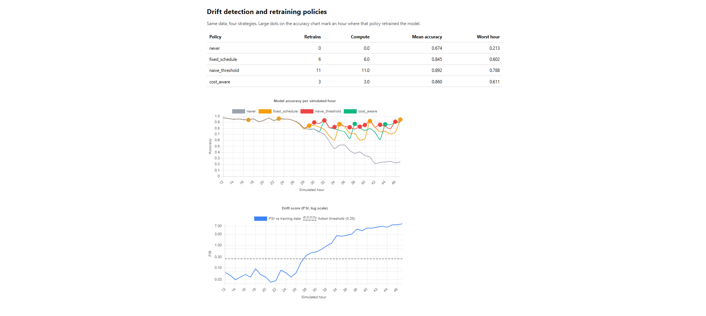

# Drift-Aware Feature Store

A small feature store (FastAPI + Postgres + Redis) that detects data drift with the Population Stability Index (PSI) and compares three policies for deciding **when to retrain** a downstream model. Everything below was measured on synthetic data, and the limits of each result are stated next to it.



## What it does

1. **Stores features twice, on purpose.** Every write goes to Postgres (full history, used for drift analysis and training) and to Redis (latest value only, fast lookups for live inference).
2. **Detects drift.** `POST /drift/check` compares a baseline time window against a current window using PSI and classifies it as stable (< 0.1), moderate (0.1 to 0.25), or significant (> 0.25).
3. **Compares retraining policies.** A simulation runs a downstream XGBoost classifier through 48 hours of drifting data under four strategies and records accuracy and compute (number of retrains).
4. **Shows the result** on a dashboard (`/dashboard`) with accuracy per policy and PSI over time.

## Architecture

```
                 +----------------------------+
  clients -----> |      FastAPI (uvicorn)     |
                 |                            |
                 |  POST /features/write -----+--> Postgres  (offline store: full history)
                 |                            +--> Redis     (online store: latest value)
                 |  GET  /features/{e}/{f} <------ Redis
                 |  POST /drift/check  <---------- Postgres (window queries, PSI)
                 |  POST /retrain/*                |
                 |  GET  /dashboard  <-- simulation over data in Postgres
                 +----------------------------+
```

`docker-compose.yml` also starts a Redpanda (Kafka-compatible) broker. The current code does not use it: the write path is synchronous. It is there for a planned streaming ingestion path (see Limitations).

## Results

All results are on synthetic data. Setup: 48 simulated hours, 200 events per hour, one feature (transaction amount) with mean 50 and standard deviation 10. Drift starts at hour 24 and ramps the mean up by 25 over 20 hours. The label is "amount is more than one standard deviation above the current regime mean", with 5% of labels flipped at random. The model is XGBoost, trained on the first 12 hours.

### 1. Drift detection works on a known drift

| Test | Windows compared | Result |
|---|---|---|
| Control (no drift) | hours 0 to 12 vs hours 12 to 24 | classified stable (PSI < 0.1) |
| Injected drift | hours 0 to 12 vs the last 11 hours | PSI about 2.8, classified significant |

### 2. The drift hurts the model, and PSI tracks it

Model trained on hours 0 to 11, scored on later hours without retraining:

| Hour | Mean amount | Accuracy | PSI vs training data |
|---|---|---|---|
| 12 | 49.2 | 0.975 | 0.062 |
| 24 | 49.8 | 0.955 | 0.060 |
| 30 | 56.8 | 0.786 | 0.511 |
| 36 | 64.2 | 0.520 | 2.711 |
| 45 | 74.8 | 0.250 | 7.974 |

### 3. Retraining policies, 10 random seeds

Each policy has one setting we sweep. "Retrains" is the compute cost. Mean accuracy covers simulated hours 12 to 47. Values are average ± standard deviation across 10 seeds.

| Policy | Setting | Retrains | Mean accuracy |
|---|---|---|---|
| never | - | 0.0 ± 0.0 | 0.672 ± 0.003 |
| fixed_schedule | every 3 h | 12.0 ± 0.0 | 0.876 ± 0.003 |
| fixed_schedule | every 6 h | 6.0 ± 0.0 | 0.844 ± 0.006 |
| fixed_schedule | every 12 h | 3.0 ± 0.0 | 0.787 ± 0.006 |
| naive_threshold | PSI ≥ 0.1 | 20.3 ± 1.6 | 0.896 ± 0.003 |
| naive_threshold | PSI ≥ 0.25 | 10.3 ± 0.6 | 0.886 ± 0.004 |
| naive_threshold | PSI ≥ 1.0 | 2.9 ± 0.3 | 0.844 ± 0.005 |
| naive_threshold | PSI ≥ 3.0 | 1.1 ± 0.3 | 0.785 ± 0.010 |
| cost_aware | value/acc. point = 2 | 1.0 ± 0.0 | 0.782 ± 0.006 |
| cost_aware | 3 | 2.0 ± 0.0 | 0.827 ± 0.006 |
| cost_aware | 5 | 3.8 ± 0.6 | 0.856 ± 0.005 |
| cost_aware | 8 | 5.9 ± 0.7 | 0.874 ± 0.004 |
| cost_aware | 12 | 8.3 ± 0.6 | 0.881 ± 0.004 |
| cost_aware | 20 | 9.6 ± 0.9 | 0.885 ± 0.003 |

Policy definitions: **fixed_schedule** retrains every N hours. **naive_threshold** retrains when the previous hour's PSI crosses a threshold. **cost_aware** retrains only when PSI is above 0.25 and the measured accuracy drop, multiplied by a value-per-accuracy-point setting, exceeds the cost of one retrain.

**What this shows**
- At roughly equal compute, the drift-triggered policies beat the fixed schedule by about 3 to 6 accuracy points (for example 0.844 at 2.9 retrains vs 0.787 at 3.0). The gaps are many times larger than the spread across seeds. One third of every fixed-schedule retrain lands before the drift starts, which wastes it.
- **The cost-aware policy did not beat a tuned PSI threshold.** At about 1 and about 10 retrains the two are within 0.003 accuracy, inside the seed spread. In this dataset drift always lowers accuracy, so the extra accuracy condition adds no information. I have not tested a "harmless drift" case, which is where the policy is designed to help.

### 4. Load testing

Measured with k6 on a single machine (12 CPUs) with k6 running on the same machine as the stack, against the API in Docker. Single runs, and the same test varied by about 10% between runs. 0 failed requests in every run listed.

**Concurrency sweep** (each virtual user loops: one write, then one read):

| API workers | Concurrent users | Requests/s | Read p95 | Write p95 |
|---|---|---|---|---|
| 1 | 10 | 277 | 31 ms | 75 ms |
| 1 | 20 | 272 | 63 ms | 137 ms |
| 1 | 50 | 337 | 140 ms | 308 ms |
| 1 | 100 | 294 | 267 ms | 603 ms |
| 4 | 50 | 886 | 50 ms | 128 ms |
| 4 | 100 | 903 | 98 ms | 236 ms |

With one worker, throughput stopped growing at about 10 users while latency kept rising with load. Four workers raised the ceiling about 2.6x at 50 users (337 to 886 requests/s) and cut write p95 from 308 ms to 128 ms.

**Where the remaining ceiling is** (100 users, same Docker setup as the 4-worker sweep; the worker count for this table was not separately verified):

| Test | Requests/s |
|---|---|
| Health check (no database work) | 4,769 |
| Read only (Redis) | 2,452 |
| Write only (Postgres + Redis) | 623 and 686 (two runs) |
| Write to Redis only | 2,774 |
| Write to Postgres only | 670 |
| Write only, Postgres `synchronous_commit` off | 735 |

The write ceiling sits in the Postgres insert path: Redis-only writes ran about 4x faster, and Postgres-only writes matched the full write. Turning off the commit wait changed throughput by less than the run-to-run variation, so commit latency is not the main cost. **Not isolated:** which part of the insert path dominates (session setup, index maintenance, or the insert itself).

## Run it locally

Requires Docker Desktop.

```bash
docker compose up --build
```

- API docs: http://localhost:8000/docs
- Dashboard: http://localhost:8000/dashboard

Reproduce the experiments (all run inside the API container):

```bash
docker exec fs_api python -m app.labeled_data      # generate labeled drifting data
docker exec fs_api python -m app.model             # accuracy and PSI per hour (table 2)
docker exec fs_api python -m app.simulate          # four policies, one seed
docker exec fs_api python -m app.experiment        # 10 seeds x policy settings (table 3)
```

Load tests use k6 (`scripts/loadtest.js`, `scripts/loadtest_modes.js`) and run in Docker:

```bash
docker run --rm --network feature-store_default -v "${PWD}/scripts:/scripts" -e VUS=50 grafana/k6 run /scripts/loadtest.js
```

## API

| Endpoint | Purpose |
|---|---|
| `POST /features/write` | Store a feature value (Postgres + Redis). |
| `GET /features/{entity}/{feature}` | Latest value from Redis |
| `POST /drift/check` | PSI between a baseline and a current window (fixed timestamps or "hours ago") |
| `GET /drift/history` | Past drift checks |
| `POST /retrain/decide` | Ask a policy whether to retrain |
| `GET /api/simulation`, `GET /dashboard` | Simulation results and the dashboard |
| `GET /health` | Liveness check |

## Tech stack

Python 3.11, FastAPI, SQLAlchemy, Postgres 16, Redis 7, XGBoost, NumPy/pandas/SciPy, Chart.js, Docker Compose, k6.

## Limitations

- **Synthetic data only.** The label rule moves with the drift by construction, so accuracy loss is built in. One drift shape (a gradual ramp) was tested.
- **Cost-aware policy** matched but did not beat a tuned threshold. The case it is designed for, benign drift where accuracy is unaffected, is untested.
- **No streaming yet.** Writes are synchronous. The Redpanda container is unused.
- **Load numbers are local.** One host, k6 on the same machine, single runs. They show where the system saturates, not production capacity.
- **Not deployed.** It runs locally with Docker Compose, and the API has no authentication.

## Repository layout

```
app/          FastAPI app, drift (PSI), policies, simulation, experiment, dashboard
scripts/      SQL schema, synthetic data generator, k6 load tests
docs/         Screenshots
```